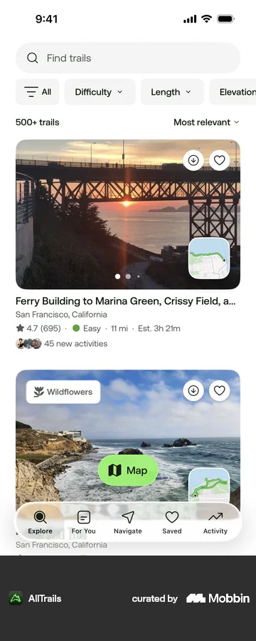
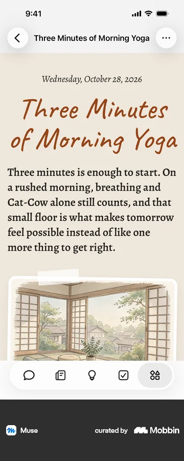
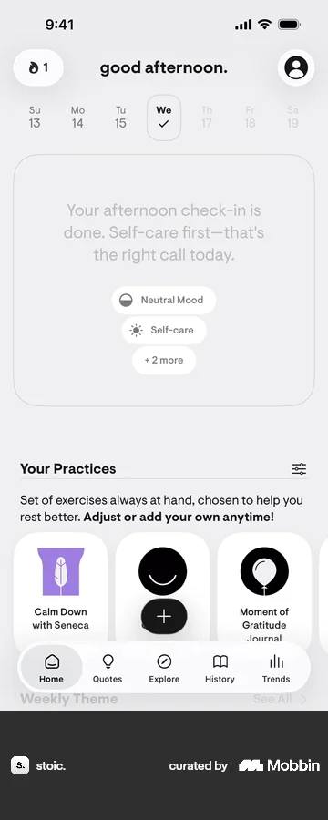

<!-- Bu dosya real-app-lab/scripts/build_readme.py ile üretilir, elle düzenlemeyin. -->

[← Tüm haftalar](../../README.md)

# Hafta 1

**Detaylı anlatım:** Yakında

<table>
<tr><td align="center" valign="top" width="33%"> <a href="alltrails/README.md"><b>AllTrails</b></a> Doğa yürüyüşü, bisiklet ve koşu rotalarını keşfettiren; rotayı indirip şebeke yokken de takip ettiren harita uygulaması.</td><td align="center" valign="top" width="33%"> <a href="muse/README.md"><b>Muse</b></a> Sohbetin ötesine geçen kişisel AI ajanı: Gmail'e bağlanır, uzak tarayıcıda iş yapar, hedef takip eder ve çıktı üretir.</td><td align="center" valign="top" width="33%"> <a href="stoic/README.md"><b>stoic.</b></a> Sabah ve akşam rutinleriyle günlük tutturan; ses, çizim ve AI mentorla destekleyen zihinsel iyi oluş uygulaması.</td></tr>
</table>

> Bu çalışma Mobbin ya da incelenen uygulamaların sahipleriyle bağlantılı değildir. Markalar sahiplerine aittir. Yorumlar akışlara bakılarak yapılmıştır; teknik dersler çıkarımdır, uygulamaların gerçek altyapısını göstermez. Her uygulama için yalnızca tanıtım amaçlı tek bir kapak görseli kullanılır (kaynak: Mobbin). Mobbin linkleri üyelik isteyebilir.
