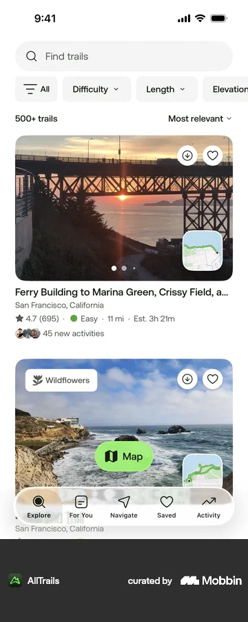
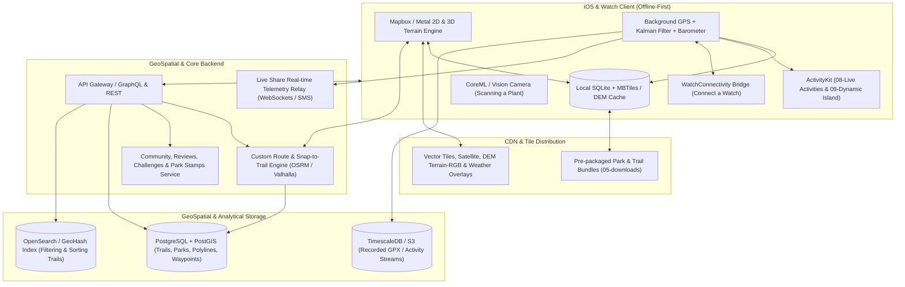
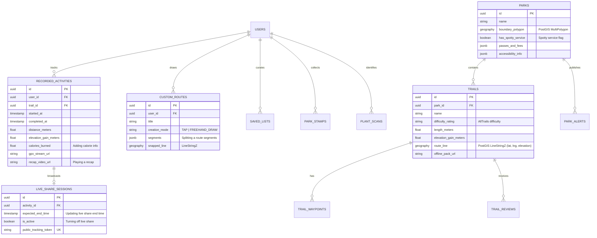
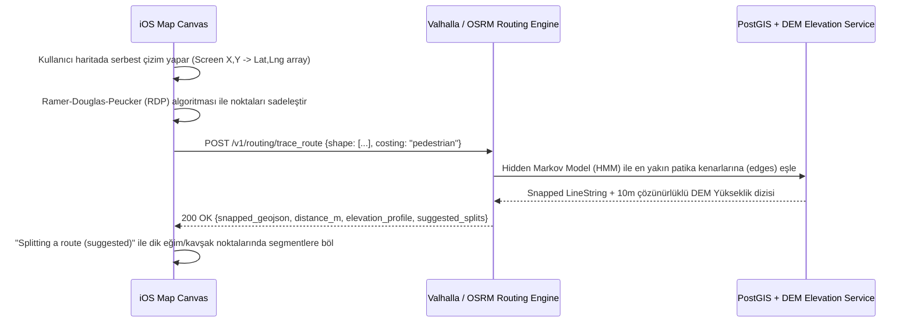

<!-- Bu dosya real-app-lab/scripts/build_readme.py ile üretilir, elle düzenlemeyin. -->

[← Hafta 1](../README.md)

# AllTrails



**[Mobbin'de tüm akışlar ↗](https://mobbin.com/apps/all-trails-ios-66ac61f7-f9ea-4c45-b512-b2fadf7e027b/9d2ea5c9-3431-4fd3-9098-df867890782a/flows)** · **Detaylı anlatım:** Yakında

- **Ne yapıyor:** Doğa yürüyüşü, bisiklet ve koşu rotalarını keşfettiren; rotayı indirip şebeke yokken de takip ettiren harita uygulaması.
- **Kimin için:** Hafta sonu yürüyüşçüleri, milli park gezginleri, patika koşucuları, dağ bisikletçileri.
- **Ana döngü:** Rota keşfet → indir → yürü → yorum ve fotoğraf ekle → sıradaki kullanıcı bu veriye güvenir.
- **Gelir modeli:** Freemium: Free, Plus ve Peak katmanları; hediye kartı.

## Önemli akışlar

1. **[İlk açılış](https://mobbin.com/flows/4c552a20-55b9-43f4-9627-97cccc7bd74f)**: Uygulamanın değerini ilk dakikada nasıl anlattığını gösterir.
   - _Teknik ders (çıkarım):_ Onboarding'i ayrı bir adım makinesi olarak kurgula.
2. **[Onboarding paywall](https://mobbin.com/flows/b74a637a-9986-4f12-ae5a-9fe2297e74fd)**: Ücretli pakete ilk davet burada.
   - _Teknik ders (çıkarım):_ Satın alma ve yetki (entitlement) durumunu tek bir yerden yönet.
3. **[Rota detayı](https://mobbin.com/flows/33d54cbf-bd8c-4100-afb8-62d544b1c5a6)**: Ürünün merkezi ekranı: karar ve çoğu aksiyon buradan başlar.
   - _Teknik ders (çıkarım):_ Yoğun detay ekranını bağımsız bölümlere ayır.
4. **[Çevrimdışı harita indirme](https://mobbin.com/flows/327ef1db-14ba-4733-9bea-359e74603f38)**: Dağda sinyal olmaması sorununu çözen temel özellik.
   - _Teknik ders (çıkarım):_ Harita parçaları için indirme kuyruğu ve yerel depo gerekir.
5. **[Navigasyon ve rotayı bitirme](https://mobbin.com/flows/0e8b3765-acf9-46a0-8c75-7ac38d7fe42e)**: Uygulamanın asıl kullanım anı.
   - _Teknik ders (çıkarım):_ Arka planda konum takibi ve pil tüketimi ana mühendislik konusu.
6. **[Yürüyüş sonrası yorum](https://mobbin.com/flows/a1e9d86f-92d8-491f-b716-bb2329a3b514)**: Topluluk verisi döngüsünü besleyen adım.
   - _Teknik ders (çıkarım):_ Katkıyı kullanıcının en istekli olduğu anda iste.
7. **[Park damgası toplama](https://mobbin.com/flows/4fa85fa7-fca4-4e4f-be12-d8305ad48408)**: Geri dönmek için oyunlaştırma nedeni.
   - _Teknik ders (çıkarım):_ Rozet kurallarını istemciden ayrı, veriyle tanımla.

## AI Prompt: bu mimariyi kendi projene uyarla

Bloğu açın, sağ üstteki kopyala butonuna basın ve kullandığınız AI aracına yapıştırın. Mimari bir **çıkarımdır**, doğrulanmış bilgi değildir.

<details>
<summary><b>Prompt'u göster</b></summary>

````markdown
Aşağıda AllTrails benzeri bir uygulama için referans bir mimari var. Bu, uygulamanın ekran akışlarından yapılan bir TAHMİNDİR, gerçek altyapısı değildir. Kendi projeme uyarlamak istiyorum. Önce bana hedef platformumu, teknoloji yığınımı ve kapsamımı sor; sonra mimariyi eleştirel değerlendirip bana uygun bir plan çıkar. Marka, tasarım ve metinleri kopyalama.

---

# AllTrails — Teknik Mimari & Öğrenim / MVP Planı

- **Platform:** iOS
- **Kategori:** Health & Fitness, Lifestyle (Outdoor, Maps & GPS Telemetry)
- **Mobbin URL:** https://mobbin.com/apps/all-trails-ios-66ac61f7-f9ea-4c45-b512-b2fadf7e027b/9d2ea5c9-3431-4fd3-9098-df867890782a/flows
- **Analiz Tarihi:** 2026-11-23

---

## 1. Yüksek Seviye Sistem Mimarisi

AllTrails'in 130 flow'u incelendiğinde; uygulamanın **Offline-First GIS (Coğrafi Bilgi Sistemi) Harita Motoru + Serbest Çizim Snap-to-Trail Rota Hesaplayıcı + Düşük Pil Tüketimli Arka Plan GPS/Barometre Telemetrisi + iOS Live Activities/Dynamic Island & Apple Watch** bileşenlerinden oluştuğu görülür:



---

## 2. Veri Modeli & ER Diyagramı (PostGIS Coğrafi Şema)



---

## 3. Kritik Flow'ların Sequence & Algoritmik Tasarımı

### 3.1 Kritik Akış 1: Parmağınla Haritada Rota Çizme ve Bölme (`Creating a custom route (draw)` -> `Splitting a route`)
Kullanıcı harita üzerinde parmağını sürükleyerek serbest bir çizgi çizdiğinde (`Creating a custom route (draw)`), bu ham ekran noktalarının gerçek patikalara oturtulması (`Map Matching`) gerekir:



### 3.2 Kritik Akış 2: Çevrimdışı Yürüyüş, Live Share & Dynamic Island (`04-navigate` + `08-live-activities` + `09-dynamic-island`)
Dağda internet kesildiğinde (`Spotty service`) bile navigasyonun kesintisiz çalışması ve pilin 8 saat dayanması için uygulanan istemci mimarisi:
1. **Local Tile & Graph Resolution:** İndirilen paket (`05-saved/downloads`) yerel SQLite/MBTiles içinden okunur. Kullanıcının GPS konumu ile `TRAILS.route_line` arasındaki dikey mesafe (**Cross-Track Distance**) cihaz üzerinde (`CLLocation` + vektör izdüşümü) saniyede bir hesaplanır; mesafe > 30m ise "Rotadan saptınız" titreşimi üretilir.
2. **Store-and-Forward Live ShareQueue:** `Live share` açıkken GPS noktaları yerel bir ring-buffer kuyruğuna yazılır; sinyal yakalandığı an batch olarak (`POST /v1/live-share/{id}/telemetry`) sunucuya akıtılır. Kullanıcı yürüyüş uzadığında `Updating live share end time` ile panik alarm süresini uzatabilir.
3. **ActivityKit (Live Activities & Dynamic Island):** Arka plan konum servisi her 50 metrelik ilerlemede `ActivityKit` state'ini güncelleyerek ekran açılmadan kilit ekranında kalan mesafeyi ve eğim grafiğini gösterir.

---

## 4. Bu Uygulamadan Öğrenilecek 5 Kritik Teknik Ders (Engineering Takeaways)

1. **Ders 1 — Serbest Çizimden Gerçek Rotaya: RDP + Map Matching (`trace_route`):**
   - Harita üzerinde serbest el çizimi (`Creating a custom route (draw)`) yüzlerce gürültülü koordinat üretir. İstemcide **Ramer-Douglas-Peucker** ile noktaları sadeleştirip, sunucuda **Valhalla `trace_attributes`** ile patika grafiğine yapıştırmak (snap-to-trail) kusursuz bir UX sağlar.
2. **Ders 2 — "Spotty Service" Proaktif Offline Mimarisi:**
   - Çoğu uygulama çevrimdışı modunu ayarların derinliklerine gizler. AllTrails ise park veritabanında `has_spotty_service = true` bayrağı tutarak kullanıcı daha evdeyken `Park detail` ekranında **"Spotty service — Download park before you go"** uyarısı çıkarır.
3. **Ders 3 — Offline Paketlerde Atomik Katmanlama (Vector Tiles + DEM + GeoJSON):**
   - Sadece 2D harita resmini indirmek yetmez; çevrimdışı 3D görünüm (`Switching to 3D view`) ve yükseklik profili için **Terrain-RGB (DEM)** karolarının ve rota poligonlarının tek bir yönetilebilir paket (`Editing map downloads`, `Clearing cache data`) olarak saklanması gerekir.
4. **Ders 4 — GPS Gürültüsüne Karşı Barometrik Sensör Füzyonu (`GPS details`):**
   - Sadece GPS yüksekliği (altitude) ağaçlık vadilerde ±40 metre sapar. Gerçek `elevation_gain` hesabı için iOS `CMAltimeter` (barometrik basınç sensörü) ile GPS verisini **Kalman Filtresi** üzerinden birleştirmek şarttır.
5. **Ders 5 — 3D Recap Videoları ile Viral Döngü (`Playing a recap`):**
   - Kaydedilen GPX izini yürüyüş sonunda 3D arazi üzerinde hareketli bir kamera animasyonuna (`Playing a recap`) dönüştürmek, kullanıcıların Instagram/TikTok'ta organik paylaşım yapmasını sağlayan en güçlü teknik büyüme kancasıdır.

---

## 5. Önerilen Tech Stack & 4 Haftalık Teknik Öğrenim / MVP Planı

- **Önerilen Tech Stack:**
  - **iOS Client:** SwiftUI + Mapbox Maps SDK v11 (3D Terrain, Offline Manager, Custom Layers) + `CoreLocation` + `CoreMotion` (`CMAltimeter`) + `ActivityKit` (Live Activities & Dynamic Island)
  - **GeoSpatial Backend:** PostgreSQL + **PostGIS** + **Valhalla** (açık kaynak yaya/patika routing & map-matching motoru)
  - **Storage & Tiles:** PMTiles / MBTiles on Cloudflare R2 (sunucusuz vektör ve terrain karo sunumu)

### Hafta 1 — PostGIS Veri Modeli, Harita Katmanları & 3D Terrain
- PostGIS üzerinde `parks`, `trails` (`LineStringZ`) ve `waypoints` tablolarını kur; GeoHash/ST_DWithin ile yakındaki rotaları filtreleme (`Filtering trails`, `Sorting trails`) API'sini yaz.
- İstemcide Mapbox 2D/3D arazi geçişini (`Switching to 3D view`), harita katmanlarını (`Adding an overlay`) ve 3D rota uçuş önizlemesini (`Playing a preview`) kodla.

### Hafta 2 — Serbest Çizim Özel Rota (`Tap & Draw`) ve Offline Harita Paketleri
- Harita üzerinde dokunarak ve parmakla çizerek rota oluşturma (`Creating a custom route (tap/draw)`), RDP sadeleştirmesi, Valhalla snap-to-trail entegrasyonu ve rotayı segmentlere bölme (`Splitting a route`) akışını kur.
- Bölge/rota bazlı çevrimdışı harita indirme (`Downloading a trail / area / park`) ve `Downloads` yönetim ekranını tamamla.

### Hafta 3 — Aktif GPS Navigasyon, Live Share, Live Activities & Dynamic Island
- Arka plan GPS + Barometre iz kaydediciyi (`04-navigate`), rotadan sapma (cross-track distance) hesaplayıcısını ve `GPS details` ekranını yaz.
- iOS `Live Activities` (`08-live-activities`), `Dynamic Island` (`09-dynamic-island`) ve `Live share` (`Updating live share end time`) gerçek zamanlı konum paylaşımını entegre et.

### Hafta 4 — AI Bitki Tarama, 3D Aktivite Recap & Oyunlaştırma (`Park Stamps`)
- Kamera ile `Scanning a plant` (CoreML Vision) ve patika üstü POI (`Searching bathrooms`, `Adding a waypoint`) özelliklerini ekle.
- Yürüyüş bitişinde (`Completing a trail`) 3D `Playing a recap` animasyonu, `Park stamps` (`Collecting a stamp`) pasaportu ve `Plus / Peak` abonelik paywall'larını tamamla.
````

</details>

> Bu çalışma Mobbin ya da incelenen uygulamaların sahipleriyle bağlantılı değildir. Markalar sahiplerine aittir. Yorumlar akışlara bakılarak yapılmıştır; teknik dersler çıkarımdır, uygulamaların gerçek altyapısını göstermez. Her uygulama için yalnızca tanıtım amaçlı tek bir kapak görseli kullanılır (kaynak: Mobbin). Mobbin linkleri üyelik isteyebilir.
