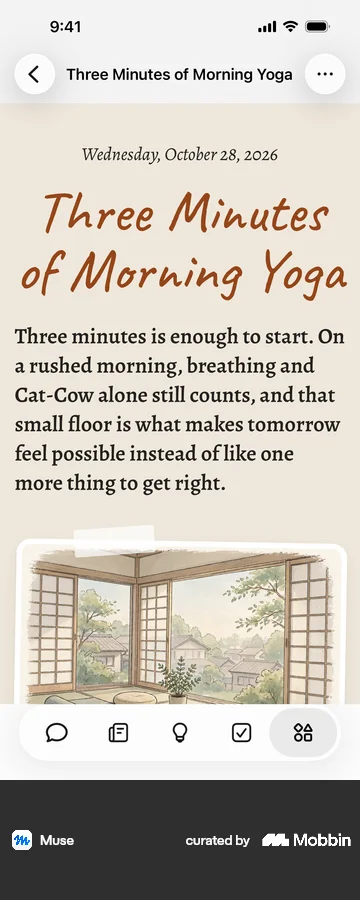
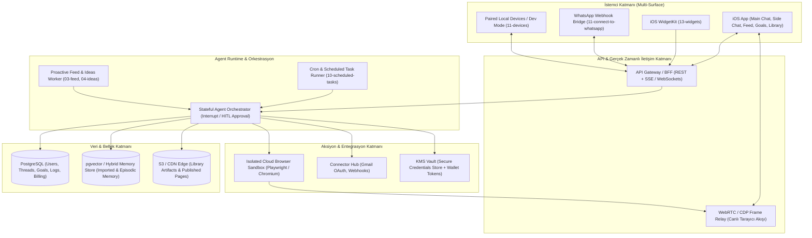
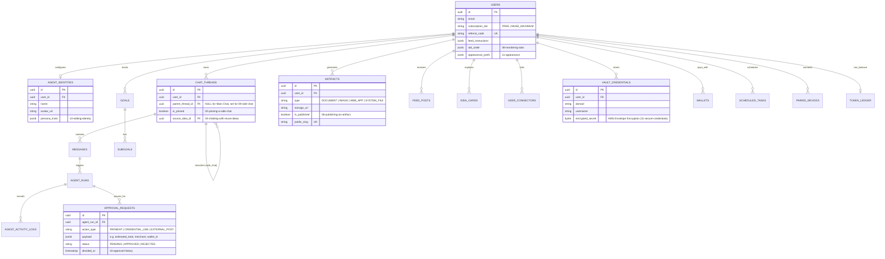
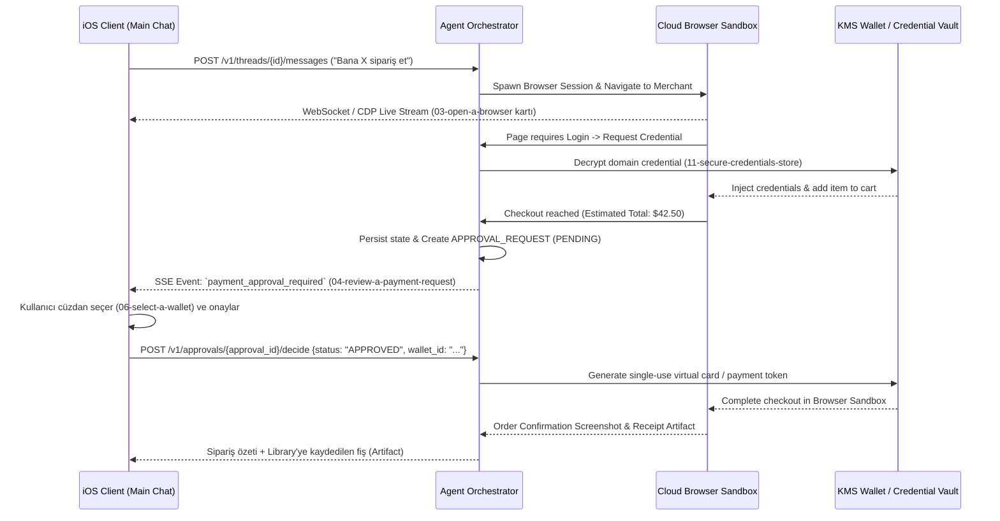

<!-- Bu dosya real-app-lab/scripts/build_readme.py ile üretilir, elle düzenlemeyin. -->

[← Hafta 1](../README.md)

# Muse



**[Mobbin'de tüm akışlar ↗](https://mobbin.com/apps/muse-ios-8e6481b3-fcd5-43b4-a9e6-abeea1fb0cdc/cecf076d-e88c-452b-bb7e-77c311324106/flows)** · **Detaylı anlatım:** Yakında

- **Ne yapıyor:** Sohbetin ötesine geçen kişisel AI ajanı: Gmail'e bağlanır, uzak tarayıcıda iş yapar, hedef takip eder ve çıktı üretir.
- **Kimin için:** Yoğun bilgi çalışanları, kurucular, içerik üreticileri, erken benimseyenler.
- **Ana döngü:** Hesaplarını bağla → ajana iş ver → onayla → sonucu Feed ve Library'de gör.
- **Gelir modeli:** Abonelik (Muse Maximum) ve ek token satışı.

## Önemli akışlar

1. **[İlk açılış](https://mobbin.com/flows/e5a8e1bd-c38b-4775-b4bd-bf713e3afe38)**: Form yerine ajanla tanışarak kurulum.
   - _Teknik ders (çıkarım):_ Uzun onboarding'de yarıda kalan durumu sakla.
2. **[Gmail bağlama](https://mobbin.com/flows/d3852bc8-f6c1-4f0d-b3e2-4dd0dcf2aed3)**: Ajan kullanıcıyı tanımaya burada başlar; boş ekran sorunu azalır.
   - _Teknik ders (çıkarım):_ OAuth token'ları sunucu tarafında ve en az yetkiyle tutulmalı.
3. **[Uzak tarayıcı](https://mobbin.com/flows/bb0ee698-1ca6-4ab8-9c44-a9a3b500dec9)**: Konuşmadan aksiyona geçişin görüldüğü an.
   - _Teknik ders (çıkarım):_ Uzun süren ajan işini canlı durum akışıyla göster.
4. **[Ödeme onayı](https://mobbin.com/flows/d0feac4a-3899-46e0-84fc-95b87887ffc3)**: Ajana para harcatırken güveni sağlayan adım.
   - _Teknik ders (çıkarım):_ Geri dönüşü olmayan işlemler insan onayından geçsin.
5. **[Hedef oluşturma](https://mobbin.com/flows/5aaa272c-b4a4-4337-a378-ba9e9e551158)**: Sohbeti kalıcı takibe çevirir.
   - _Teknik ders (çıkarım):_ Hedefi sohbet mesajı değil, ayrı bir veri modeli yap.
6. **[Çıktı yayınlama](https://mobbin.com/flows/fbf862ce-d9dc-4115-9388-fd92be8a5857)**: Üretilen işi dışarı taşır; büyüme kanalı olabilir.
   - _Teknik ders (çıkarım):_ Yayınlamada görünürlük ve geri çekme kontrolü gerekir.
7. **[Ek token satın alma](https://mobbin.com/flows/2ab35844-ba45-4888-b257-2fc3994a791a)**: Ağır kullanımın maliyetini gelire bağlar.
   - _Teknik ders (çıkarım):_ Kredi bakiyesini sunucuda defter (ledger) olarak tut.

## AI Prompt: bu mimariyi kendi projene uyarla

Bloğu açın, sağ üstteki kopyala butonuna basın ve kullandığınız AI aracına yapıştırın. Mimari bir **çıkarımdır**, doğrulanmış bilgi değildir.

<details>
<summary><b>Prompt'u göster</b></summary>

````markdown
Aşağıda Muse benzeri bir uygulama için referans bir mimari var. Bu, uygulamanın ekran akışlarından yapılan bir TAHMİNDİR, gerçek altyapısı değildir. Kendi projeme uyarlamak istiyorum. Önce bana hedef platformumu, teknoloji yığınımı ve kapsamımı sor; sonra mimariyi eleştirel değerlendirip bana uygun bir plan çıkar. Marka, tasarım ve metinleri kopyalama.

---

# Muse — Teknik Mimari & Öğrenim / MVP Planı

- **Platform:** iOS
- **Kategori:** Productivity, Lifestyle (Personal AI Agent)
- **Mobbin URL:** https://mobbin.com/apps/muse-ios-8e6481b3-fcd5-43b4-a9e6-abeea1fb0cdc/cecf076d-e88c-452b-bb7e-77c311324106/flows
- **Analiz Tarihi:** 2026-11-23

---

## 1. Yüksek Seviye Sistem Mimarisi

Muse'un 83 flow'u incelendiğinde, uygulamanın basit bir LLM sarmalayıcısı (wrapper) değil; **Otonom Tarayıcı Sandbox'ı + Şifre/Cüzdan Kasası + Zamanlanmış Görev Orkestratörü + Çoklu Kanal (iOS, Widget, WhatsApp, Bağlı Cihazlar)** barındıran tam teşekküllü bir **Agentic Operating System** mimarisine sahip olduğu görülür:



---

## 2. Veri Modeli & ER Diyagramı (83 Flow'dan Çıkarılan Şema)



---

## 3. Kritik Flow'ların Sequence & API Tasarımı

### 3.1 Kritik Akış 1: Otonom Tarayıcı ile Sipariş & Ödeme Onayı (`02-main-chat` -> `Open a browser` -> `Placing an order` -> `Review a payment request`)
Muse'un teknik olarak en öğretici akışı, ajanın bulutta tarayıcı açıp alışveriş yaparken **ödeme adımında durup kullanıcıdan onay istemesidir (Human-in-the-Loop Interrupt)**:



### 3.2 Kritik Akış 2: Proaktif Feed & Doğal Dil Algoritma Güncellemesi (`03-feed` -> `Updating feed instructions`)
- **Endpoint:** `PATCH /v1/feed/instructions`
  - **Payload:** `{ "instructions_prompt": "Focus on AI engineering, summarize my unread Gmail invoices, hide celebrity news" }`
- **Negative/Positive Signal Endpoint:**
  - `POST /v1/feed/posts/{id}/like` (`03-liking-a-post`)
  - `DELETE /v1/feed/posts/{id}` (`04-deleting-a-post`)
- **Teknik Mekanizma:** Silinen ve beğenilen kartlar, kullanıcının `feed_instructions` sistem prompt'una **Few-Shot tercih örnekleri** olarak eklenir; bir sonraki digest üretiminde LLM bu pozitif/negatif sinyalleri dikkate alır.

---

## 4. İstemci Mimarisi (Client-Side UI, Navigation & State)

1. **Dinamik Sıralanabilir Navigasyon (`08-reordering-tabs`):**
   - Uygulamanın ana modülleri (`Main Chat`, `Feed`, `Ideas`, `Goals`, `Library`, `AI Agent`) statik bir `UITabBar` yerine kullanıcı tarafından sırası değiştirilebilen (`tab_order` state) dinamik bir sekmeli koordinatörle yönetilir.
2. **İki Katmanlı Sohbet Mimarisi (`02-main-chat` vs. `09-side-chat`):**
   - **Main Chat:** Kullanıcının ajanla olan sürekli, uzun ömürlü (persistent) ana iletişim kanalıdır.
   - **Side Chat:** Ana sohbetin ortasında hızlı bir yan konu araştırmak için kayan panel (sheet/drawer) olarak açılır (`Pinning a side chat` ile sabitlenebilir veya işi bitince silinebilir).
3. **Çoklu Girdi (Multimodal Composer):**
   - Metin, görsel (`Chatting with Muse (image input)`), gerçek zamanlı ses transkripsiyonu (`Transcribing audio to text`) ve iOS ana ekran `Widget`'larından derin link (deep-link) ile tetikleme.

---

## 5. Bu Uygulamadan Öğrenilecek 5 Kritik Teknik Ders (Engineering Takeaways)

1. **Ders 1 — Ajanlar İçin "Human-in-the-Loop (HITL) State Checkpointing" Şarttır:**
   - Otonom bir ajan ödeme veya dış dünyaya veri gönderme adımına geldiğinde süreci bellekte (`in-memory`) bekletemezsiniz. Ajanın çalışma durumu (`AgentRunState`) veritabanına serileştirilmeli (ör. LangGraph checkpointer veya Temporal workflow), kullanıcı 3 saat sonra `Review a payment request` ekranında "Onayla"ya bastığında kaldığı yerden devam edebilmelidir.
2. **Ders 2 — "Side Chat" ile Context Window Kirliliğini Önleme:**
   - Tek bir sonsuz sohbette ("Main Chat") alakasız yan sorular sorulduğunda LLM'in bağlam penceresi kirlenir ve token maliyeti patlar. Muse'un `09-side-chat` akışı, hem UX hem de LLM context engineering açısından parlak bir çözümdür.
3. **Ders 3 — Şeffaf Denetim İzi (`Activity Log` + `Approval History`) Güven İnşa Eder:**
   - Kullanıcıdan Gmail izni, web şifreleri (`Secure credentials store`) ve cüzdan (`Wallet`) istiyorsanız, `10-ai-agent` altındaki `Activity log information` ve `Approval history` gibi her adımı şeffafça gösteren bir denetim ekranı sunmak zorundasınız.
4. **Ders 4 — Bellek Taşınabilirliği (`Importing memory` & `Resetting Muse`):**
   - `11-settings/22-importing-memory` akışı, kullanıcıların rakip AI asistanlardaki (ChatGPT/Claude) bellek/bağlam verilerini tek adımda içeri aktarmasını sağlayarak cold-start problemini mühendislik yoluyla çözer.
5. **Ders 5 — Abonelik + Kredi Top-Up (`Subscribe` + `Buy additional tokens`) Muhasebesi:**
   - Arka planda headless browser ve cron job çalıştıran bir uygulamada sadece sabit aylık ücretle zarar edilir. Veritabanında atomik bir `TOKEN_LEDGER` (kredi defteri) tutularak, abonelik kotası bittiğinde IAP üzerinden consumable token paketleri satılmalıdır.

---

## 6. Önerilen Tech Stack & 4 Haftalık Teknik Öğrenim / MVP Planı

Bu mimariyi bizzat kodlayarak öğrenmek veya benzer bir **Personal AI Agent** MVP'si çıkarmak için 4 haftalık uygulama planı:

- **Önerilen Tech Stack:**
  - **Mobile Client:** Flutter veya SwiftUI (Streaming Markdown, WebSocket/WebRTC mini-player, Reorderable Tab Bar, WidgetKit)
  - **Backend & Agent Runtime:** Python (FastAPI + LangGraph / Temporal) veya TypeScript (Node.js + Vercel AI SDK / Trigger.dev)
  - **Cloud Browser Sandbox:** Playwright + Browserbase / Steel.dev (canlı oturum yayını ve DOM aksiyonları için)
  - **Database & Memory:** Supabase / PostgreSQL + `pgvector` (ilişkisel tablolar + semantik bellek)
  - **Security Vault:** AWS KMS / HashiCorp Vault (envelope encryption ile şifre ve OAuth token saklama)

### Hafta 1 — Çekirdek Sohbet, Side Chat Dallanması & Bellek İskeleti
- PostgreSQL şemasını (`users`, `chat_threads`, `messages`, `memory_entries`) kur.
- `Main Chat` + `Side Chat` (`parent_thread_id` ile dallanma, pinleme, silme) ve ses/görsel girdili multimodal mesajlaşma akışını tamamla.
- `Importing memory` ve `Resetting memory` endpoint'lerini yaz.

### Hafta 2 — Bağlayıcılar (Gmail OAuth) + Proaktif Modüller (`Feed`, `Ideas`, `Goals`)
- Gmail OAuth2 bağlantısını (`Connecting to Gmail`) ve arka plan e-posta özetleme worker'ını kur.
- Doğal dille güncellenebilen `Feed` (`Updating feed instructions`), `Ideas` ve hiyerarşik `Goals / Subgoals` modüllerini ajan tool-call'larına bağla.

### Hafta 3 — Cloud Browser Sandbox & Human-in-the-Loop Ödeme/İşlem Onayı
- İzole Playwright tarayıcı container'ını (`Open a browser`, `Starting a browser`) sohbet ekranına canlı stream olarak bağla.
- `Review a payment request` / `Approval history` state-machine mekanizmasını (ajanın kritik aksiyonda durup kullanıcıdan onay beklemesi ve onay sonrası devam etmesi) ve `Activity log` ekranını kodla.

### Hafta 4 — Library Artifacts, Zamanlanmış Görevler & Hibrit Monetization
- Ajanın ürettiği çıktıları `Library`'de listeleme ve `Publishing an artifact` ile public web linki olarak yayınlama sistemini kur.
- `Scheduled tasks` (zamanlanmış ajan görevleri) ve `TOKEN_LEDGER` tabanlı `Subscribe + Buy additional tokens` paywall akışını tamamla.
````

</details>

> Bu çalışma Mobbin ya da incelenen uygulamaların sahipleriyle bağlantılı değildir. Markalar sahiplerine aittir. Yorumlar akışlara bakılarak yapılmıştır; teknik dersler çıkarımdır, uygulamaların gerçek altyapısını göstermez. Her uygulama için yalnızca tanıtım amaçlı tek bir kapak görseli kullanılır (kaynak: Mobbin). Mobbin linkleri üyelik isteyebilir.
