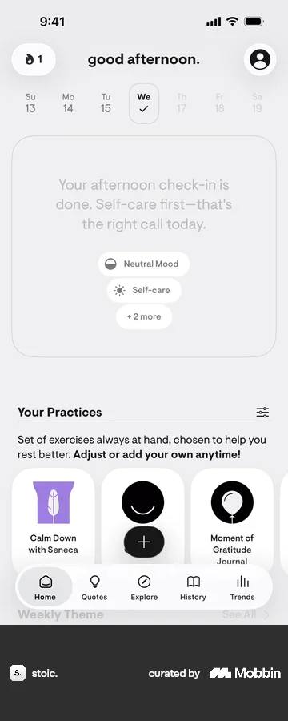
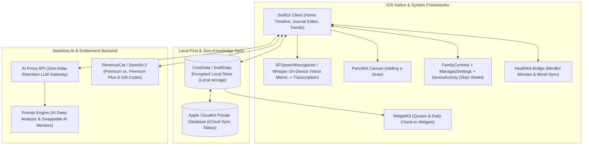
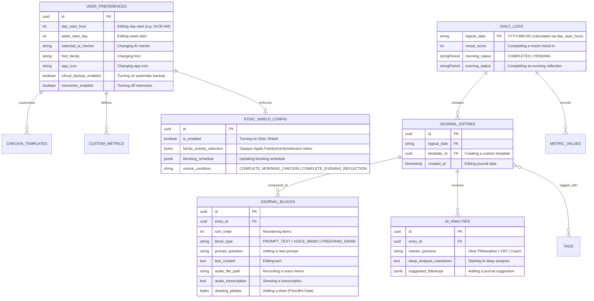
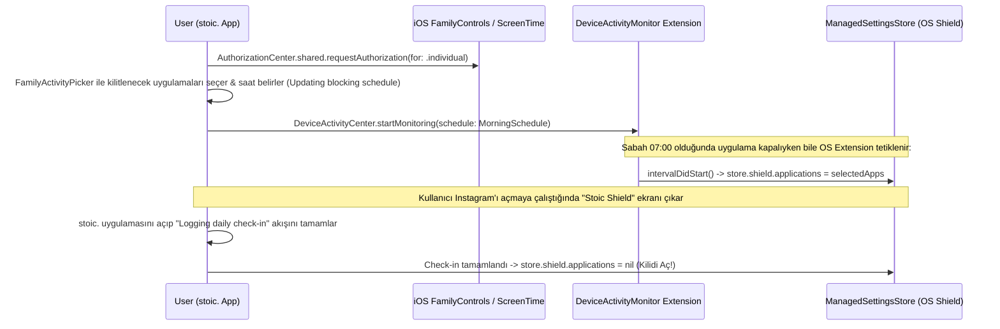

<!-- Bu dosya real-app-lab/scripts/build_readme.py ile üretilir, elle düzenlemeyin. -->

[← Hafta 1](../README.md)

# stoic.



**[Mobbin'de tüm akışlar ↗](https://mobbin.com/apps/stoic-ios-621f0be7-8046-45cd-b667-97add5f9c3c7/fd166e24-39ab-43ac-96ad-1095935c93fe/flows)** · **Detaylı anlatım:** Yakında

- **Ne yapıyor:** Sabah ve akşam rutinleriyle günlük tutturan; ses, çizim ve AI mentorla destekleyen zihinsel iyi oluş uygulaması.
- **Kimin için:** Kendini tanımak isteyenler, odaklanma sorunu yaşayanlar, boş sayfada tıkananlar.
- **Ana döngü:** Check-in yap → günlük yaz → AI analizi al → trendlerini gör → ertesi gün dön.
- **Gelir modeli:** İki katmanlı abonelik (Premium, Premium Plus/AI) ve hediye abonelik.

## Önemli akışlar

1. **[Premium paywall](https://mobbin.com/flows/dcfb6b10-37f2-4bd1-ad76-c34d61c78a69)**: İki paketin nasıl sunulduğunu gösterir.
   - _Teknik ders (çıkarım):_ Katmanlı abonelikte yetkileri özellik bazında kontrol et.
2. **[Günlük check-in kurulumu](https://mobbin.com/flows/64fe4566-9666-4303-87a5-0c5905935890)**: Alışkanlığı kullanıcıya göre şekillendirir.
   - _Teknik ders (çıkarım):_ Check-in adımlarını yapılandırılabilir veri olarak tasarla.
3. **[Sesli günlük](https://mobbin.com/flows/74ec906f-380a-4080-874c-d769f1878f3f)**: Yazma zorluğunu azaltır.
   - _Teknik ders (çıkarım):_ Kayıt, izin ve yerel dosya yönetimi ayrı ele alınmalı.
4. **[AI derin analiz](https://mobbin.com/flows/ce487bc0-91eb-461d-81ca-db1e2d74f6d7)**: Yazılanı geri bildirime çeviren AI özelliği.
   - _Teknik ders (çıkarım):_ Hassas veride açık rıza ve minimum veri gönderimi şart.
5. **[Trendler](https://mobbin.com/flows/fec9e20b-3070-4306-96fd-5d42bf18ab84)**: Biriken veriyi görünür kılar; geri dönme nedeni.
   - _Teknik ders (çıkarım):_ Özet metrikleri önceden hesaplayıp sakla.
6. **[Stoic Shield](https://mobbin.com/flows/bd010f3e-40ba-44be-b97a-3aa2df04f6b3)**: Günlük yazmayı uygulama engellemeye bağlayan en ayırt edici fikir.
   - _Teknik ders (çıkarım):_ iOS'ta Screen Time API'leri ve özel izin gerektirir.
7. **[Alıntı paylaşma](https://mobbin.com/flows/20aa8528-6cce-4cc0-a747-3049ac6b4264)**: Basit bir organik yayılma kancası.
   - _Teknik ders (çıkarım):_ Paylaşım görselini cihazda üret.

## AI Prompt: bu mimariyi kendi projene uyarla

Bloğu açın, sağ üstteki kopyala butonuna basın ve kullandığınız AI aracına yapıştırın. Mimari bir **çıkarımdır**, doğrulanmış bilgi değildir.

<details>
<summary><b>Prompt'u göster</b></summary>

````markdown
Aşağıda stoic. benzeri bir uygulama için referans bir mimari var. Bu, uygulamanın ekran akışlarından yapılan bir TAHMİNDİR, gerçek altyapısı değildir. Kendi projeme uyarlamak istiyorum. Önce bana hedef platformumu, teknoloji yığınımı ve kapsamımı sor; sonra mimariyi eleştirel değerlendirip bana uygun bir plan çıkar. Marka, tasarım ve metinleri kopyalama.

---

# stoic. — Teknik Mimari & Öğrenim / MVP Planı

- **Platform:** iOS
- **Kategori:** Health & Fitness, Lifestyle (AI Journaling, Gratitude Diary & Mental Wellbeing)
- **Mobbin URL:** https://mobbin.com/apps/stoic-ios-621f0be7-8046-45cd-b667-97add5f9c3c7/fd166e24-39ab-43ac-96ad-1095935c93fe/flows
- **Analiz Tarihi:** 2026-11-23

---

## 1. Yüksek Seviye Sistem Mimarisi

`stoic.` uygulamasının 75+ flow'u incelendiğinde, mimarisinin **"Local-First Privacy (Yerel Veritabanı + Özel iCloud Senkronizasyonu) + iOS Sistem API'leri (`Screen Time / FamilyControls`, `HealthKit`, `Speech`, `PencilKit`) + Stateless/Zero-Retention AI Proxy"** prensibi üzerine kurulduğu görülür:



---

## 2. Veri Modeli & ER Diyagramı (Local-First SwiftData / CoreData Şeması)



---

## 3. Kritik Flow'ların Sequence & Sistem Tasarımı

### 3.1 Kritik Akış 1: "Stoic Shield" — Günlük Yazana Kadar Uygulamaları Kilitleme (`07-profile` -> `Turning on Stoic Shield`)
Bu akış iOS'un `FamilyControls`, `DeviceActivity` ve `ManagedSettings` framework'lerinin birlikte çalıştığı harika bir sistem mühendisliği örneğidir:



### 3.2 Kritik Akış 2: Multimodal Günlük + AI Deep Analysis & Mentor Değiştirme (`02-home` -> `Logging a journal` -> `Starting AI deep analysis`)
1. **Blok Tabanlı Editör (`JOURNAL_BLOCKS`):** Bir günlük kaydı tek bir `String` değildir; sıralanabilir (`Reordering items`) metin blokları, ses kaydı + cihaz içi canlı transkripsiyon (`Recording a voice memo` -> `Showing a transcription`) ve `PKCanvasView` çizim (`Adding a draw`) bloklarından oluşan bir dizidir.
2. **Anlık AI İpucu (`Adding a journal suggestion`):** Kullanıcı yazarken takıldığında, o ana kadar yazdığı paragraf stateless AI endpoint'ine gönderilir ve 3 adet derinleştirici soru önerisi ("Bunu kontrol edemediğin bir şey olarak mı görüyorsun?") döner.
3. **Persona Değiştirilebilir Derin Analiz (`Starting AI deep analysis` -> `Changing AI mentor`):** Kullanıcı günlüğü bitirdiğinde `Starting AI deep analysis` tetiklenir; kullanıcı analiz ekranında `Changing AI mentor` ile farklı bir bakış açısı seçtiğinde aynı günlük girdisi yeni mentorun sistem prompt'uyla yeniden yorumlanır.

---

## 4. Bu Uygulamadan Öğrenilecek 5 Kritik Teknik Ders (Engineering Takeaways)

1. **Ders 1 — `day_start_hour` ("Mantıksal Gün") Hesaplaması (`Editing day start`):**
   - Günlük ve alışkanlık uygulamalarında en büyük bug gece yarısı (`00:00`) problemidir. Gece 01:30'da akşam değerlendirmesi (`Completing an evening reflection`) yazan bir kullanıcının kaydı ertesi güne yazılırsa streak'i bozulur. `stoic.` bunu `Editing day start` ayarıyla çözer: `logical_date = (now - day_start_hour).toDate()`.
2. **Ders 2 — iOS `Screen Time API` (`FamilyControls`) ile Davranışsal Kilit (`Stoic Shield`):**
   - `DeviceActivityMonitor` extension'ı kullanarak belirli saatlerde hedef uygulamaları (`ManagedSettingsStore.shield`) kilitlemek ve ana uygulamada görev (`Completing daily check-in`) bittiğinde kilidi açmak, iOS'ta yapılabilecek en güçlü retention mekanizmasıdır.
3. **Ders 3 — Mahremiyet İçin "Local-First + CloudKit + Stateless AI Proxy" Üçlüsü:**
   - Kullanıcıların en mahrem düşüncelerini yazdığı bir uygulamada merkezi bir PostgreSQL veritabanında açık metin tutmak hem KVKK/GDPR hem de güvenlik açısından büyük risktir. Veriyi `SwiftData + CloudKit Private DB`'de tutup, sadece `Starting AI deep analysis` anında veriyi loglamayan (`zero-retention`) bir LLM proxy'sine göndermek hem maliyeti sıfırlar hem de tam gizlilik sağlar.
4. **Ders 4 — Şema-Tabanlı Dinamik Check-in Motoru (`Setting up daily check-in`):**
   - Kullanıcının check-in adımlarını eklemesi (`Adding items`), silmesi (`Removing an item`), sıralaması (`Reordering items`), yeni metrik (`Adding a new metric`) ve yeni soru (`Adding a new prompt`) tanımlaması; ekranların sabit kodlu değil **JSON/Schema-Driven Dynamic Form** olarak render edildiğini gösterir.
5. **Ders 5 — Paywall İçinde Downsell (`Subscribing to Premium Plus` -> `Premium`):**
   - İlk paywall yüksek fiyatlı `Premium Plus (AI)` paketini sunar; kullanıcı pahalı bulursa paywall'dan tamamen çıkmak yerine aynı akış içindeki `Premium` (AI içermeyen daha uygun fiyatlı paket) sekmesine düşerek dönüşüm oranını maksimize eder.

---

## 5. Önerilen Tech Stack & 4 Haftalık Teknik Öğrenim / MVP Planı

- **Önerilen Tech Stack:**
  - **iOS Client:** SwiftUI + **SwiftData / CoreData + NSPersistentCloudKitContainer** (Otomatik iCloud Sync)
  - **Multimodal & System Frameworks:** `SFSpeechRecognizer` / `WhisperKit` (On-device ses->metin), `PencilKit` (Çizim), `HealthKit` (Nefes & Mindful dakikalar), `FamilyControls` / `ManagedSettings` / `DeviceActivity` (Stoic Shield), `WidgetKit`
  - **AI Proxy & Monetization:** Cloudflare Workers / FastAPI (Stateless LLM Streaming Proxy) + RevenueCat (`Premium` & `Premium Plus` + Gift Codes)

### Hafta 1 — Local-First Veri Modeli, "Mantıksal Gün" (`day_start_hour`) & Dinamik Check-in
- `SwiftData` + `CloudKit` (`Turning on automatic backup` / `iCloud sync status`) altyapısını ve `logical_date` (`Editing day start`) tarih motorunu kur.
- Kullanıcının kendi adımlarını, metriklerini (`Adding a new metric`) ve sorularını (`Adding a new prompt`) sıralayabildiği (`Reordering items`) dinamik `Daily Check-in` motorunu yaz.

### Hafta 2 — Multimodal Günlük Editörü (Metin + Ses Transkripsiyon + Çizim) & AI Deep Analysis
- Blok tabanlı günlük editörünü (`Editing text`, `Recording a voice memo` -> `Showing a transcription`, `Adding a draw`) kodla.
- `Adding a journal suggestion` (yazarken anlık AI soru önerisi) ve `Starting AI deep analysis` + `Changing AI mentor` (değiştirilebilir AI mentor personaları) akışını entegre et.

### Hafta 3 — "Stoic Shield" (Screen Time API), Nefes Egzersizi & HealthKit
- `FamilyControls` ve `DeviceActivityMonitor` ile sabah/akşam check-in tamamlanana kadar seçili uygulamaları kilitleyen **`Stoic Shield`** (`Updating blocking schedule`, `Setting up Stoic Schedule`) modülünü geliştir.
- Haptik/sesli (`Changing chimes`) nefes egzersizi (`Completing a breathing practice`) ve `HealthKit` senkronizasyonunu tamamla.

### Hafta 4 — History, Mood Calendar Trends, Quotes, Widgets & İki Katmanlı Paywall
- `History` (zaman/etiket filtreleme) ve `Trends` (`Mood calendar` ve metrik korelasyon grafikleri) ekranlarını oluştur.
- `Quotes` (sesli dinleme + paylaşılabilir kart), iOS `Widgets` ve `Premium Plus -> Premium` + `Gift Stoic Premium AI` paywall akışlarını tamamla.
````

</details>

> Bu çalışma Mobbin ya da incelenen uygulamaların sahipleriyle bağlantılı değildir. Markalar sahiplerine aittir. Yorumlar akışlara bakılarak yapılmıştır; teknik dersler çıkarımdır, uygulamaların gerçek altyapısını göstermez. Her uygulama için yalnızca tanıtım amaçlı tek bir kapak görseli kullanılır (kaynak: Mobbin). Mobbin linkleri üyelik isteyebilir.
